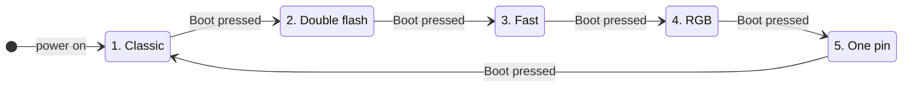
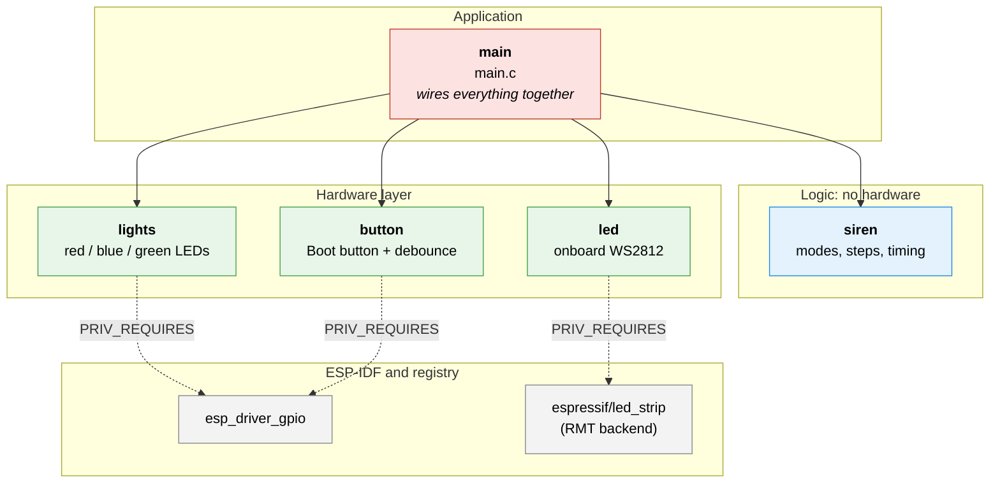
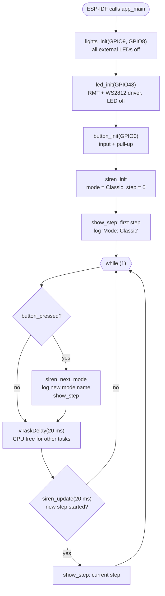
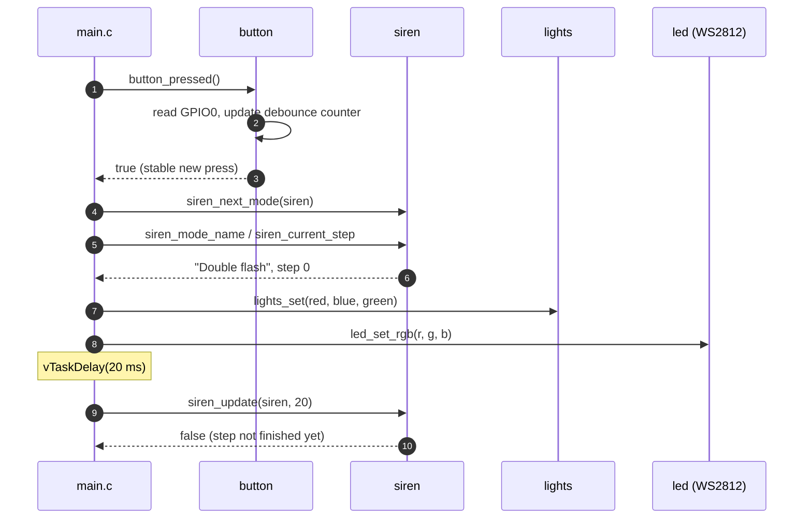
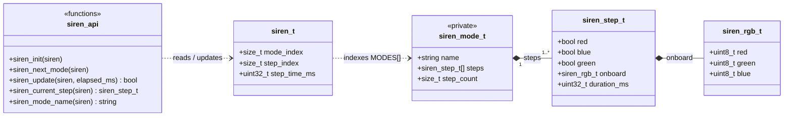
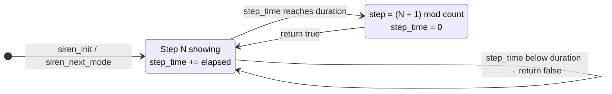
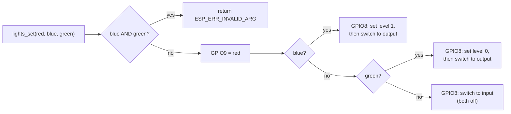
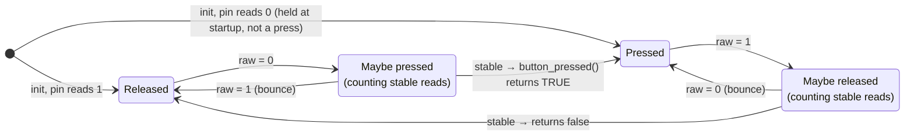
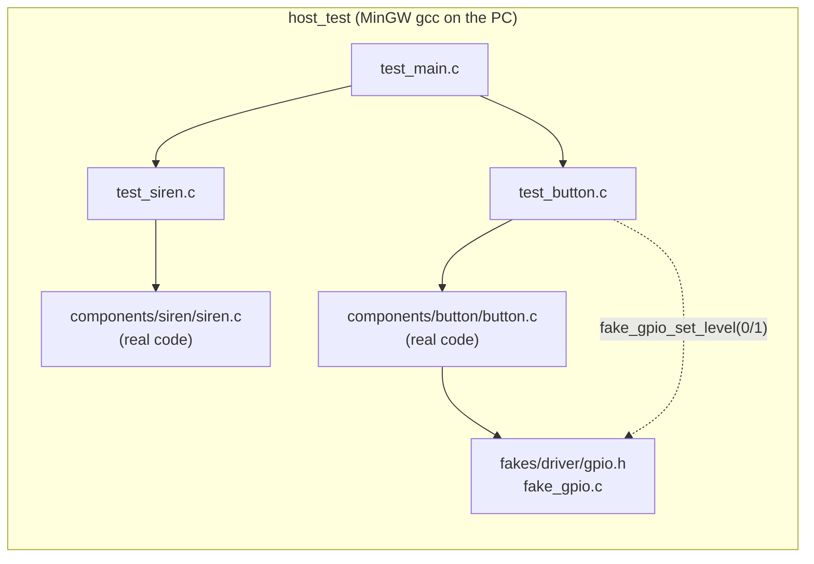

# 🚨 Lesson 1.3 — Police Siren Lights (ESP32-S3)


Homework for the **Beetroot Academy** embedded course, lesson 1.3. An ESP32-S3 drives LEDs that flash like police siren lights. Pressing the **Boot** button switches between five blinking modes.

---

## 📑 Contents

1. [The homework](#-the-homework)
2. [What was built](#-what-was-built)
3. [Hardware and wiring](#-hardware-and-wiring)
4. [Architecture](#-architecture)
5. [How the program runs](#-how-the-program-runs)
6. [The components in detail](#-the-components-in-detail)
7. [Design decisions](#-design-decisions)
8. [Host tests](#-host-tests)
9. [Build and flash](#-build-and-flash)
10. [Settings you can change](#-settings-you-can-change)
11. [Troubleshooting: what I learned](#-troubleshooting-what-i-learned)

---

## 📝 The homework

The full task is in [`TASK.md`](TASK.md).

> Write an ESP32 program that controls two LEDs (red and blue) and simulates police siren lights.

| Requirement | Status | How |
|---|:---:|---|
| Use two GPIO pins | ✅ | Red on **GPIO9**, blue on **GPIO8** |
| Connect the LEDs through resistors | ✅ | Each LED has its own series resistor (220–330 Ω) |
| Red and blue blink alternately | ✅ | **Classic** mode |
| Run in a continuous loop | ✅ | `while (1)` in `app_main` |
| ⭐ Extra: more complex pattern | ✅ | **Double flash** mode (two short flashes per color) |
| ⭐ Extra: a third LED | ✅ | External **green** LED, plus the onboard **RGB** LED |
| ⭐ Extra: vary the speed | ✅ | **Fast** mode, and modes switch with a button press |
| ⭐ Extra: two LEDs on one GPIO | ✅ | **One pin** mode: blue and green alternate on GPIO8 alone |

---

## 💡 What was built

The board starts in **Classic** mode. Each press of **Boot** moves to the next mode. After the last mode it goes back to the first.



| # | Mode | What you see | One cycle |
|---|------|--------------|-----------|
| 1 | **Classic** | Red and blue take turns, 0.4 s each | 800 ms |
| 2 | **Double flash** | Red flashes twice, then blue flashes twice | 720 ms |
| 3 | **Fast** | Red and blue take turns, 0.1 s each | 200 ms |
| 4 | **RGB** | External LEDs off. The onboard RGB LED goes red → green → blue | 1500 ms |
| 5 | **One pin** | Blue and green take turns, 0.4 s each, both driven by **GPIO8** | 800 ms |

### Timing charts

Each character is **20 ms**, which is one pass of the main loop. `█` = LED on, `·` = LED off.

```text
Classic         0 ms                400 ms              800 ms
  red   GPIO9   ████████████████████····················
  blue  GPIO8   ····················████████████████████

Double flash    60  60  60    180     60  60  60    180   (ms)
  red   GPIO9   ███···███···························
  blue  GPIO8   ··················███···███·········

Fast            100 ms per step
  red   GPIO9   █████·····█████·····█████·····█████·····
  blue  GPIO8   ·····█████·····█████·····█████·····█████

One pin         both LEDs on ONE pin
  blue  GPIO8   ████████████████████····················
  green GPIO8   ····················████████████████████
  GPIO8 level   HIGH────────────────LOW─────────────────

RGB             500 ms per color, onboard WS2812 only
  WS2812        [ red ··········· ][ green ········· ][ blue ·········· ]
```

The serial log prints every mode change:

```text
I (290) siren: Mode: Classic (press Boot to change)
I (4120) siren: Mode: Double flash
I (7350) siren: Mode: Fast
I (9800) siren: Mode: RGB
I (11520) siren: Mode: One pin
I (13980) siren: Mode: Classic
```

---

## 🔌 Hardware and wiring

| Item | Details |
|------|---------|
| Board | ESP32-S3-DevKitC-1 compatible clone (USB-UART chip **CH343**, shows up as COM5) |
| Red LED | **GPIO9** → resistor → LED → GND (on when HIGH) |
| Blue LED | **GPIO8** → resistor → LED → GND (on when HIGH) |
| Green LED | **3V3** → resistor → LED → **GPIO8** (on when LOW). Shares the blue LED's pin |
| Onboard RGB LED | Addressable **WS2812** on **GPIO48** |
| Mode button | Onboard **Boot** button, **GPIO0**. Pressing it connects the pin to GND |

```text
                        ESP32-S3
                  ┌──────────────────┐
  red   LED ◄─[R]─┤ GPIO9            │        R = 220–330 Ω
                  │                  │
  blue  LED ◄─[R]─┤ GPIO8 ───┐       │        blue : GPIO8 ─[R]─►|─ GND
  green LED ─[R]──┤ 3V3      │       │        green: 3V3   ─[R]─►|─ GPIO8
                  │          │       │
  Boot button ────┤ GPIO0    │ (pull-up, pressed = 0)
  WS2812 DIN  ────┤ GPIO48   │ (onboard)
                  └──────────┴───────┘

  Complete paths:
    GPIO9 ──[R]──►|── red   ── GND        GPIO9 HIGH  →  red on
    GPIO8 ──[R]──►|── blue  ── GND        GPIO8 HIGH  →  blue on
    3V3   ──[R]──►|── green ── GPIO8      GPIO8 LOW   →  green on
```

### How two LEDs share one pin

A GPIO has **three** useful states, not two. When it is an **input**, it does not drive the line high or low, and neither LED lights.

| GPIO8 state | Blue (pin → LED → GND) | Green (3V3 → LED → pin) |
|---|---|---|
| Output **HIGH** (3.3 V) | 🔵 **on** | off: 3.3 V on both sides |
| Output **LOW** (0 V) | off: 0 V on both sides | 🟢 **on** |
| **Input** (not driving) | off | off |

When the pin is an input, the only path left is 3V3 → green → blue → GND. Green needs about 2 V and blue about 3 V to light up, which is about 5 V in total. The 3.3 V supply is too low, so no current flows and both LEDs stay dark.

> ⚠️ Blue and green can never be on together, because the pin can't be HIGH and LOW at once. `lights_set()` rejects that combination with `ESP_ERR_INVALID_ARG`, and a host test checks that no mode asks for it.

### Why the onboard LED is not a normal blink

The red, blue and green LEDs are switched with `gpio_set_level(pin, 1/0)`. The onboard LED is a **WS2812**, a "smart" LED with its own small controller chip. It takes a **single data wire** carrying very precisely timed pulses:

- Each color is **8 bits** (0–255), so one LED needs **24 bits** (sent in green, red, blue order).
- The LED tells a `0` bit from a `1` bit by the length of the HIGH pulse: about 0.4 µs vs 0.8 µs.
- After it receives its 24 bits, the LED keeps showing that color until new data arrives.

A constant HIGH or LOW on GPIO48 is not a valid message, so the LED ignores it. The program uses the ESP32's **RMT** peripheral instead. RMT is hardware that generates exact pulse trains on its own, and the program drives it through Espressif's [`led_strip`](https://components.espressif.com/components/espressif/led_strip) component:

```c
led_strip_set_pixel(strip, 0, 16, 16, 16); // "ON": store a color for LED #0
led_strip_refresh(strip);                  //       ...and send it
led_strip_clear(strip);                    // "OFF": send black (0, 0, 0)
```

---

## 🏗️ Architecture

The code is split into **ESP-IDF components**, each with one job. Dependencies point in **one direction only**. `main` uses the other components, the hardware components use the ESP-IDF drivers, and `siren`, which holds the logic, depends on nothing.



| Layer | Knows about | Does **not** know about |
|---|---|---|
| `main` | The four component headers | GPIO driver, RMT, `led_strip` |
| `siren` | Plain C only (`stdbool`, `stdint`) | Any hardware at all |
| `lights` / `button` | `driver/gpio.h` | Modes, timing, each other |
| `led` | `led_strip.h` | Modes, timing, GPIO driver |

**The build enforces these rules.** A component can only `#include` headers from components listed in its `REQUIRES` / `PRIV_REQUIRES`:

- `siren` lists nothing, so `#include "driver/gpio.h"` in `siren.c` **fails to compile**.
- The drivers are listed as `PRIV_REQUIRES` (private), so `main.c` can't reach them either. It only sees `lights.h`, `led.h` and `button.h`.
- The top-level `CMakeLists.txt` sets `MINIMAL_BUILD ON`, so only `main` and the components it needs get built.

### Project layout

```text
Lesson_1_3_Blink/
├── CMakeLists.txt              # top-level project, MINIMAL_BUILD ON
├── dependencies.lock           # pinned version of led_strip
├── TASK.md                     # the homework text
├── main/
│   ├── CMakeLists.txt          # PRIV_REQUIRES lights led button siren
│   └── main.c                  # app_main: setup + main loop
├── components/
│   ├── siren/                  # 🧠 logic: modes + timing        (no REQUIRES)
│   ├── lights/                 # 💡 external LEDs                 (PRIV_REQUIRES esp_driver_gpio)
│   ├── led/                    # 🌈 onboard WS2812                (PRIV_REQUIRES led_strip)
│   │   └── idf_component.yml   #    declares espressif/led_strip
│   └── button/                 # 🔘 Boot button                   (PRIV_REQUIRES esp_driver_gpio)
└── host_test/                  # 🧪 Unity tests that run on the PC
    ├── fakes/                  #    fake driver/gpio.h + esp_err.h
    ├── test_siren.c
    ├── test_button.c
    └── run_tests.ps1
```

Each component has the same shape: a `CMakeLists.txt`, its public header in `include/`, and one `.c` file. Only headers in `include/` are visible to other code. Pin numbers, driver handles and mode tables stay private.

---

## ⚙️ How the program runs

### Startup and main loop (activity diagram)



Every hardware call is wrapped in `ESP_ERROR_CHECK(...)`. If anything fails, the program stops with a clear error message and the source line, instead of carrying on in a broken state.

### One loop pass (sequence diagram)

This is what happens during the 20 ms pass in which the user presses Boot:



### Why poll every 20 ms instead of sleeping for a whole step?

| Option | Problem |
|---|---|
| `vTaskDelay(400)` per step | During a 400 ms or 500 ms step the button isn't read, so presses get missed or feel slow |
| **Short loop, 20 ms ticks** ✅ | The button is checked 50× per second, and every step duration is a multiple of 20 ms |

---

## 🧩 The components in detail

### 🧠 `siren`: modes and timing (pure logic)

Each mode is a `const` **table of steps**. A step says which LEDs are on, the onboard color, and how long the step lasts. Fields left out default to `0`/`false` (off), so each row only lists what is lit:

```c
static const siren_step_t CLASSIC[] = {
    {.red = true, .duration_ms = 400},
    {.blue = true, .duration_ms = 400},
};
```

All modes are listed in one `MODES[]` table. **Adding a mode means writing a step list and adding one row.** No `if`/`switch` code changes.



`main.c` owns the state (`siren_t`) and passes it to every function. `main.c` reports what happened and asks what to show:

| Function | Meaning |
|---|---|
| `siren_init(&s)` | Start at the first step of the first mode |
| `siren_next_mode(&s)` | The button was pressed. Go to the next mode, step 0, timer 0 |
| `siren_update(&s, ms)` | Time passed. Returns `true` when a new step starts |
| `siren_current_step(&s)` | What to show right now |
| `siren_mode_name(&s)` | Text for the log |

How `siren_update` moves through the steps of one mode:



### 💡 `lights`: external LEDs (hardware)

| Function | Meaning |
|---|---|
| `lights_init(red_gpio, blue_green_gpio)` | Red pin becomes an output, shared pin an input, all LEDs off |
| `lights_set(red, blue, green)` | Red: HIGH/LOW. Shared pin: HIGH, LOW or input (see the table above) |

How `lights_set` decides what to do with the shared pin:



The level is set **before** the pin is switched to output. If the order were reversed, the pin could briefly drive its old level and flash the wrong LED.

### 🌈 `led`: onboard WS2812 (hardware)

This is the only code in the project that knows the LED is a WS2812.

| Function | Meaning |
|---|---|
| `led_init(gpio)` | Sets up 1 WS2812 in GRB order on RMT at **10 MHz** (0.1 µs resolution), then turns it off |
| `led_set_rgb(r, g, b)` | `led_strip_set_pixel` + `led_strip_refresh`. `0, 0, 0` = off |

### 🔘 `button`: Boot button with debouncing (hardware)

Mechanical contacts **bounce**: for a few milliseconds after a press or release, the reading flickers between 0 and 1. Without filtering, one press could skip two modes. The button counts a new reading only after it stays the same for `BUTTON_STABLE_READS` (2) extra checks in a row, which is about 40–60 ms at a 20 ms poll.



`button_pressed()` returns `true` **exactly once per press**, on the released → pressed edge. Holding the button or releasing it never counts.

### 🎛️ `main.c`: wiring it together

`main.c` holds the pin `#define`s, calls the `*_init` functions, and runs the loop shown above. Its only helper is `show_step()`, which sends one `siren_step_t` to `lights_set()` and `led_set_rgb()`. All sequencing logic lives in `siren`.

---

## 🧭 Design decisions

| # | Decision | Why | Alternative not chosen |
|---|---|---|---|
| 1 | **Split into components** (`siren`, `lights`, `led`, `button`) | Each part has one job and can be read, tested and reused on its own. The build enforces the boundaries | Everything in `main.c`: shorter at first, but hard to read once there are 5 modes |
| 2 | **`siren` has no hardware dependencies** | The logic can be compiled and **tested on a PC**. The compiler stops anyone from adding a `gpio_*` call there | Calling `gpio_set_level` straight from the pattern code |
| 3 | **Modes as data tables** (`siren_step_t[]`) | A new mode is one table plus one row. Timing is easy to see and tweak | A `switch` per mode with hard-coded delays: more code, easy to get wrong |
| 4 | **Caller owns the state** (`siren_t` passed by pointer) | No hidden globals in the logic, and each test starts from a fresh state | Static variables inside `siren.c` |
| 5 | **20 ms polling loop** with `vTaskDelay` | The button responds quickly in every mode, and the code stays simple for a beginner course (no interrupts, timers or extra tasks) | GPIO interrupt + FreeRTOS timer: more responsive, but much more to understand |
| 6 | **Debounce by counting stable reads** | A few lines, no timers, easy to test with a fake pin | Hardware RC filter, or an ISR plus a timer |
| 7 | **Button held at startup is not a press** | The first state is read at `button_init`, so holding Boot through reset doesn't skip a mode | Assuming "released" at startup |
| 8 | **Tri-state pin for blue + green** | Meets the "one GPIO for two LEDs" extra. The input state uses the sum of the LED forward voltages (≈5 V > 3.3 V) to switch both off | Two pins (doesn't meet the extra), or charlieplexing more LEDs (too much for this lesson) |
| 9 | **Set level before output direction** | Prevents a short glitch of the wrong LED when the shared pin changes state | Switching direction first |
| 10 | **RMT + `led_strip` for the WS2812** | A WS2812 needs sub-microsecond timing that `gpio_set_level` can't produce | Bit-banging the pin by hand |
| 11 | **`led_strip` declared in `components/led`** | The dependency belongs to the code that uses it, and `main` never sees it (`PRIV_REQUIRES`) | Declaring it in `main/idf_component.yml` |
| 12 | **Onboard brightness 32 / 255** | WS2812s are very bright at full power | Full brightness |
| 13 | **Errors returned as `esp_err_t`, checked in `main`** | Components pass errors up and `ESP_ERROR_CHECK` stops with a clear message | Ignoring return values |
| 14 | **`MINIMAL_BUILD ON`** | Faster builds. Only `main` and its required components get compiled | Building every ESP-IDF component |

---

## 🧪 Host tests

`host_test/` is a separate CMake project that runs **on the PC**, without the board. It uses **Unity**, the same test framework ESP-IDF uses on the chip, taken from the ESP-IDF install.



- **`siren`** needs no fakes, because it is pure logic.
- **`button`** is compiled against a **fake** `driver/gpio.h`. The test chooses what the pin reads with `fake_gpio_set_level()`.

| Suite | What is tested |
|---|---|
| `siren` (9 tests) | Starts in Classic with red on • a step lasts exactly its duration • 20 ms ticks add up • steps wrap around • modes cycle in order and wrap • a new mode starts fresh • RGB mode uses only the onboard LED • **no step in any mode turns on blue and green together**, and every step lasts more than 0 ms |
| `button` (7 tests) | No press while released • holding counts once • a press needs stable reads • releasing is not a press • two presses count twice • bounce is ignored • holding at startup is not a press |

Run them:

```powershell
.\host_test\run_tests.ps1          # add -Clean to rebuild from scratch
```

The script builds with the MinGW gcc in `C:\CTOOLS\mingw32\bin` and exits non-zero if any test fails.

---

## 🔧 Build and flash

Requires **ESP-IDF v6.0** (from the Espressif installer or the VS Code ESP-IDF extension). From an ESP-IDF terminal in the project folder:

```bash
idf.py set-target esp32s3     # first time only (sdkconfig is not in git)
idf.py build                  # downloads led_strip on the first build
idf.py -p COM5 flash          # your port, e.g. /dev/ttyUSB0 on Linux
idf.py -p COM5 monitor        # view the log, exit with Ctrl+]
```

`.vscode/` and `.devcontainer/` hold the editor and container setup for the ESP-IDF VS Code extension.

---

## 🎚️ Settings you can change

| Define | File | Meaning |
|--------|------|---------|
| `RED_LED_GPIO`, `BLUE_GREEN_LED_GPIO` | `main/main.c` | Pins of the external LEDs |
| `ONBOARD_LED_GPIO` | `main/main.c` | Data pin of the onboard WS2812 (48 on this board) |
| `BUTTON_GPIO` | `main/main.c` | Mode button pin |
| `LOOP_PERIOD_MS` | `main/main.c` | How often the button and the timer are checked |
| `duration_ms` in the step tables | `components/siren/siren.c` | How long each step lasts. Use multiples of `LOOP_PERIOD_MS` |
| `ONBOARD_BRIGHTNESS` | `components/siren/siren.c` | Onboard LED brightness, 0–255 |
| `BUTTON_STABLE_READS` | `components/button/button.c` | How many equal readings in a row count as a real press or release |

---

## 🩺 Troubleshooting: what I learned

- **The RGB LED pin depends on the board.** Espressif's DevKitC-1 v1.0 uses GPIO48 and v1.1 uses GPIO38. My board looks like a v1.1, but it is a clone and its LED is on **GPIO48**. With GPIO38 the RGB LED stayed dark.
- **`gpio_set_level` cannot drive a WS2812.** The LED needs timed data pulses, which is why the project uses RMT and `led_strip`.
- **Buttons bounce.** A single press can read as several quick presses. The `button` component filters this out, and the host tests prove it.
- **The Boot button is special only at reset.** Holding it while the board starts enters download (flash) mode. Once the program is running, it is a normal input.
